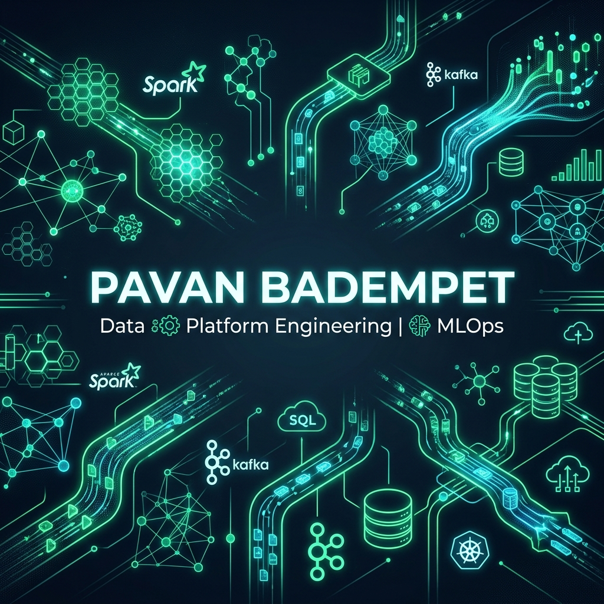

# 👋 Hi, I'm Pavan Badempet

## 🌌 Data & MLOps Platform Engineer | Big Data Architect

I am a **Data Engineer and MLOps Platform Specialist** focused on building high-throughput, low-latency data platforms, distributed ETL pipelines, and scalable machine learning infrastructure. My expertise lies in designing robust lakehouse architectures (Delta Lake, Lakefs), orchestrating complex workflows (Apache Airflow), and engineering production-grade ML pipelines.

Experienced in implementing healthcare interoperability gates (ABDM compliance), real-time vital signal streaming analytics, and deep learning clinical ensembles (FT-Transformers, Bi-LSTM temporal models) with automated cloud retraining triggers.

---

### 🚀 Technical Superpowers

<table>
  <tr>
    <td valign="top" width="50%">
      <h4><b>💻 Languages & Core</b></h4>
      <code>Python</code> • <code>Scala</code> • <code>SQL (PostgreSQL, MySQL, SQLite)</code> • <code>TypeScript</code> • <code>Go</code> • <code>Bash</code>
        
      <h4><b>📊 Big Data & Orchestration</b></h4>
      <code>Apache Spark</code> • <code>PySpark Streaming</code> • <code>Delta Lake</code> • <code>Apache Airflow</code> • <code>Apache Hadoop</code> • <code>Databricks</code> • <code>Data Quality (Great Expectations)</code>
    </td>
    <td valign="top" width="50%">
      <h4><b>🤖 Machine Learning & MLOps</b></h4>
      <code>Scikit-learn</code> • <code>PyTorch</code> • <code>TensorFlow</code> • <code>TabPFN</code> • <code>Kaggle API</code> • <code>Hugging Face Hub</code> • <code>Conformal Prediction</code>
        
      <h4><b>☁️ Cloud, Databases & DevOps</b></h4>
      <code>AWS (EMR, S3, EC2, RDS, IAM)</code> • <code>Docker</code> • <code>Kubernetes</code> • <code>GitHub Actions CI/CD</code> • <code>Pinecone / SimpleVectorStore</code> • <code>Allembic / migrations</code>
    </td>
  </tr>
</table>

---

### 📂 Featured Production Projects

#### 🏥 [AI-Healthcare-System](https://github.com/pavanbadempet/AI-Healthcare-System)
*Production-ready enterprise clinical decision support and health-informatics platform.*
* **SOTA Ensemble Modeling**: Built a 6-model voting ensemble utilizing XGBoost, LightGBM, CatBoost, RandomForest, and custom PyTorch `FT-Transformer` classifiers.
* **Temporal Attention**: Implemented sequence-based `ClinicalTemporalLSTM` models to predict risk trajectories over longitudinal patient visit history.
* **Automated MLOps**: Architected serverless cloud retraining loops using Kaggle API and private Hugging Face Dataset model storage, removing large model files from git history.
* **Interoperability**: Designed Ayushman Bharat Digital Mission (ABDM) sandbox gateways and FHIR compliance validation gates.

#### 🎬 [Movie-Recommendation-System](https://github.com/pavanbadempet/Movie-Recommendation-System)
*Scalable recommender engine utilizing distributed data pipelines.*
* Implemented Collaborative Filtering, Matrix Factorization, and Deep Learning recommendation frameworks.
* Structured data ingestion pipelines to process millions of rating events.

#### 📱 [Universe-Dex](https://github.com/pavanbadempet/Universe-Dex)
*Interactive index registry and dashboard manager.*
* Designed a responsive Single Page Application (SPA) using React, Vite, TypeScript, and TailwindCSS.
* Integrated robust state management and mock data engineering backends.

---

### 📊 GitHub Activity & Metrics

  
  

  

---

### 🌐 Connect & Collaborate

* 💼 **LinkedIn:** [Pavan Badempet](https://www.linkedin.com/in/pavanbadempet/)
* ✍️ **Blog & Portfolio:** [pavanbadempet.github.io](https://pavanbadempet.github.io)
* 💬 **Stack Overflow:** [Pavan Badempet Profile](https://stackoverflow.com/users/6325621/pavan-badempet)
* 📮 **Get in Touch:** Shoot me an email or open an issue on any of my repositories!

<!-- Hidden SEO Keywords to optimize crawler indexing:
Data Engineer, MLOps, Big Data Architect, PySpark Specialist, Apache Spark Developer, Delta Lake Lakehouse, Apache Airflow pipelines, ETL developer, PyTorch Deep Learning Tabular data, Hugging Face Hub integration, Python Scala AWS engineer, Ayushman Bharat Digital Mission software engineer, FAANG grade data engineer portfolio, Pavan Badempet Github.
-->
